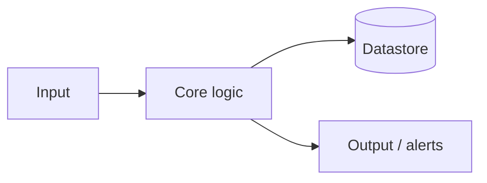

# Architecture

How {{PROJECT_NAME}} works under the hood.

## Overview

<!-- 2–4 sentences describing the system at a high level. -->

{{PROJECT_NAME}} is composed of ... . At a high level it ... .

## Components

| Component    | Responsibility                               |
| ------------ | -------------------------------------------- |
| Component A  | ...                                          |
| Component B  | ...                                          |
| Component C  | ...                                          |

## Data flow

```text
┌──────────┐      ┌──────────┐      ┌──────────┐
│  Input   │ ───> │  Core    │ ───> │  Output  │
└──────────┘      └──────────┘      └──────────┘
```

<!-- Replace the diagram above with a real one. Mermaid works in GitHub wikis: -->



## Key design decisions

- **Decision 1** — rationale and trade-offs.
- **Decision 2** — rationale and trade-offs.

## External dependencies

- Service / library — what it's used for.

## Failure modes & resilience

- What happens on failure, retries, backoff, alerting, etc.
